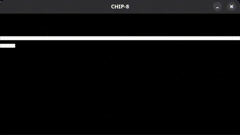
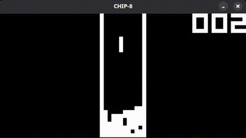
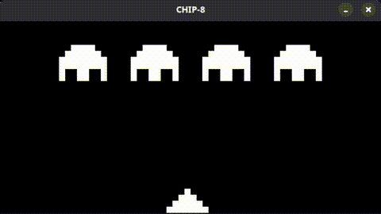

# CHIP-8 Emulation Project for STM32F411E-Discovery board

[](#)
[](#)
[](https://github.com/dviracachas/STM32F411E_CHIP_Emulator_Project/actions/workflows/build.yaml)

For-fun project to learn how to use the STM32F411E-Discovery board by making a CHIP-8 emulator, using CMSIS and direct compilation only.

# 🕹️ Game Demos
<div style="display: flex; flex-wrap: wrap; gap: 10px; justify-content: center;">
  
  
  
</div>

# 🗺️ Roadmap
Current tasks and progress are reported in the related [GitHub Project](https://github.com/users/dviracachas/projects/3).

# 📚️ Used technologies
- Toolchain: `arm-none-eabi-gcc` v16.2.0-1
- Build System: `make` v4.4.1-3
- Flasher: `st-flash` (stlink) v1.8.0-121

# 📁 Organization

This repo is organized as a monorepo that will include various projects sharing base libraries located in `vendor/` as submodules.
```text
.
├── linker/                   # Shared linker script
├── vendor/                   # Git submodules (CMSIS 6, CMSIS Device F4 and STM32 Cube F4)
└── projects/                 # Subprojects added over time
    └── Simple_LED_blink/     # Base output test
    └── Simple_button_LED/    # Base input/output test
    └── Simple_UART/          # Serial printing using USART2
    └── Chip-8/               # Core, platform and test implementations
```

# 🛠️ How to use
- This repo uses submodules from STM32 vendors. The following command ensures these are also downloaded while cloning:
```bash
# Clone with submodules
git clone --recurse-submodules https://github.com/dviracachas/STM32F411E_CHIP_Emulator_Project.git
```
- To compile and upload a project to the board (Chip-8 still in the making):
```bash
# Compile a project
cd projects/<SELECTED_PROJECT>/
make

# Flash the board
make flash
```
- To run a Chip-8 ROM in the PC:
```bash
# Compile the core
cd projects/Chip-8/
make build/chip8

# Execute the ROM
./build/chip8 <PATH_TO_YOUR_ROM>
```
